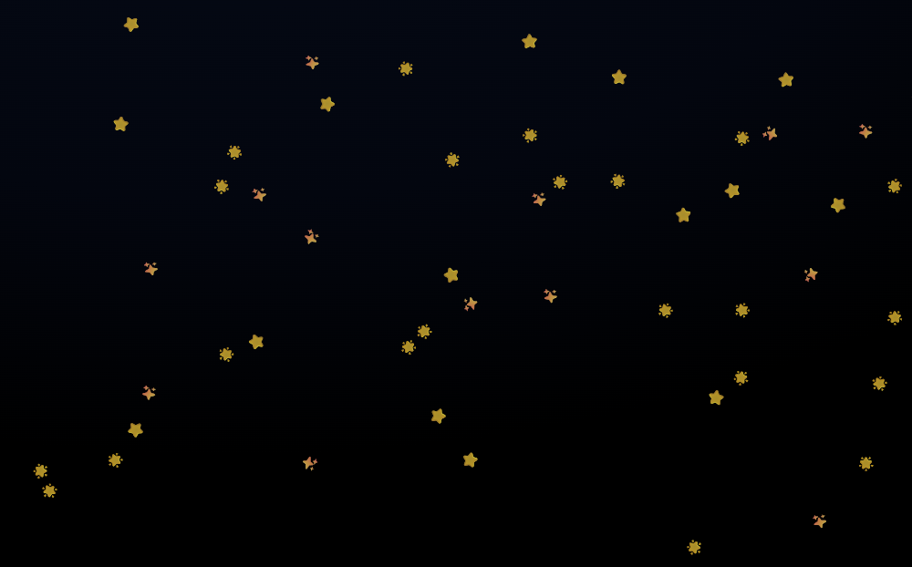
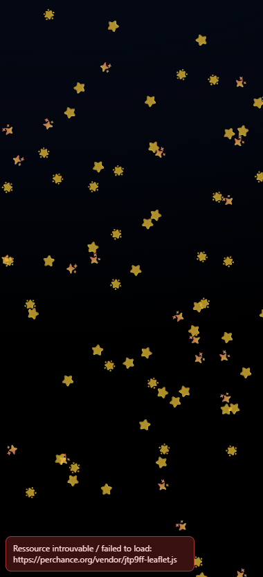

  
  <h1>geo-atlas</h1>
  
<i>Bilingual EN/FR giant interactive atlas-book: planisphere, 250 countries, thematic maps, versus, quiz, passport. 100% interactive & animated.</i>

  
<b>Category:</b> Tools / Generator

  <a href="https://T2Smart-AI.github.io/perchance-geo-test/">🚀 Live Demo</a> | <a href="showcase.html">🖼️ Showcase</a>

  
  
  

---

## 🇫🇷 Français

### Description
**geo-atlas** est un moteur de génération d'atlas interactif conçu comme un livre géant. Il permet d'explorer le monde à travers une planisphère animée, des cartes thématiques et des outils de comparaison pour plus de 250 pays.

### Fonctionnalités
- **Navigation Globale** : Planisphère interactive, vue par continents et exploration A-Z.
- **Analyses Thématiques** : Cartes dédiées à la population, la densité urbaine et la politique.
- **Outils Interactifs** : 
  - `Versus` & `Comparateur` : Comparez deux pays instantanément.
  - `Quiz` : Testez vos connaissances géographiques.
  - `Passeport` : Collectionnez vos visites de pays.
- **Expérience Utilisateur** : Mode nuit, rotation du globe (avec pause), et destinations surprises.

### Contrôles
- **Souris/Toucher** : Cliquez sur les boutons de l'interface pour naviguer entre les pages (Couverture, Monde, Continents, Thématiques, Pays, Comparateur, Quiz, Passeport).
- **Interface** : Utilisez les boutons de navigation $\leftarrow$ / $\rightarrow$ pour feuilleter l'atlas.

### Quickstart
- **Windows** : Double-cliquez sur `start.cmd`.
- **macOS/Linux** : Exécutez `sh start.sh`.
- **Alternative** : `python3 -m http.server` (Un serveur HTTP est requis pour charger les modules ES).

### Personnalisation (Tunables)
| Variable | Description | Valeur par défaut |
| :--- | :--- | :--- |
| `theme` | Apparence visuelle (Jour/Nuit) | Light |
| `rotation` | Vitesse de rotation du globe | Active |

### Structure du Projet
- `src/app.js` : Cœur de l'application.
- `src/globe3d.js` : Moteur de rendu 3D.
- `src/i18n.js` : Gestion du bilinguisme.
- `src/data/` : Fichiers JSON (pays, hymnes, géométrie).

### Stack Technique
- **Langages** : JavaScript (ES Modules), CSS3, HTML5.
- **Librairies** : Three.js (0.160.0), Leaflet (1.9.4).
- **Audio** : Web Audio API.
- **Stockage** : localStorage.

### Déploiement & Licence
- **Déploiement** : Optimisé pour GitHub Pages.
- **Licence** : MIT.

---

## 🇬🇧 English

### Description
**geo-atlas** is a generator-style interactive atlas designed as a giant book. It allows users to explore the world via an animated planisphere, thematic maps, and comparison tools for over 250 countries.

### Features
- **Global Navigation** : Interactive planisphere, continent views, and A-Z country browsing.
- **Thematic Maps** : Dedicated layers for population, urban density, and political boundaries.
- **Interactive Tools** : 
  - `Versus` & `Comparator`: Side-by-side country analysis.
  - `Quiz`: Geography knowledge challenges.
  - `Passport`: A virtual collection of visited countries.
- **User Experience** : Night mode, globe rotation control, and surprise destination feature.

### Controls
- **Mouse/Touch** : Click UI buttons to switch pages (Cover, World, Continents, Themes, Countries, Comparator, Quiz, Passport).
- **Interface** : Use $\
