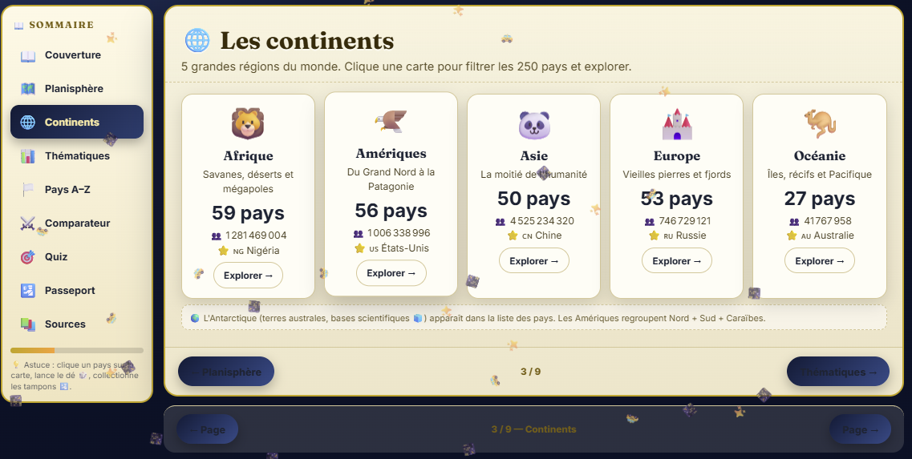
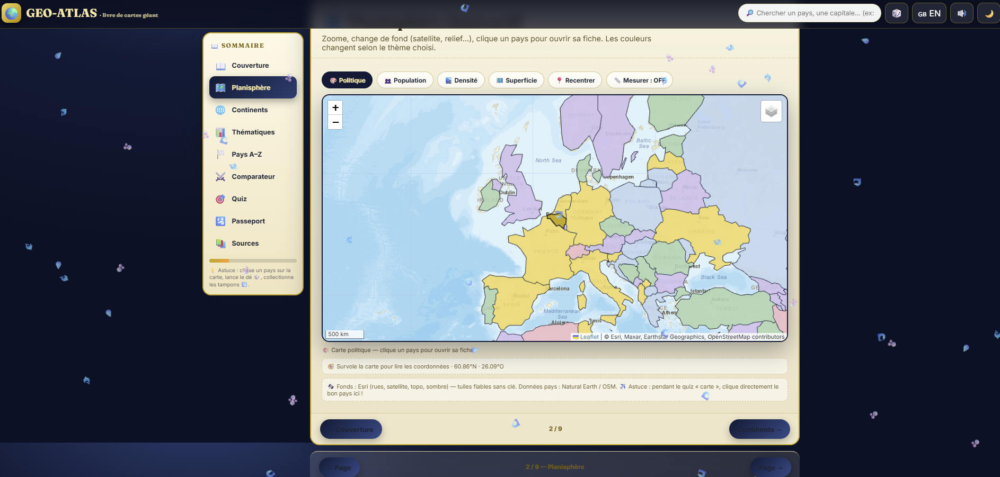
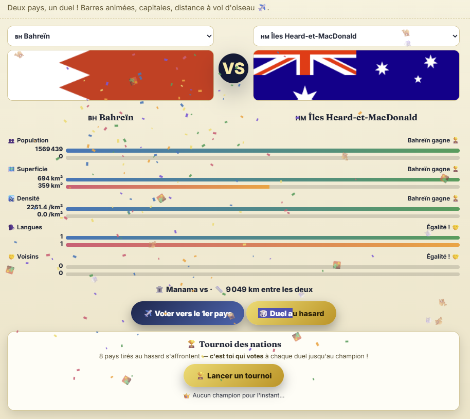
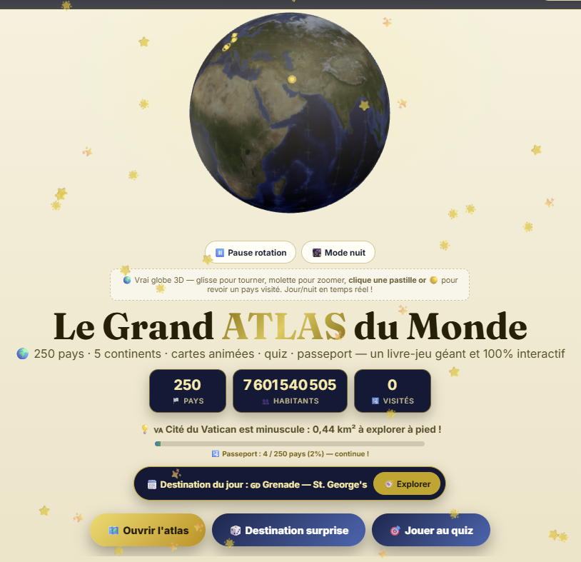

  
  <h1>geo-atlas</h1>
  
<i>Atlas-livre géant bilingue : planisphère interactif, 250 pays, cartes thématiques, versus, quiz et passeport. 100% interactif et animé.</i>

  <a href="https://T2Smart-AI.github.io/perchance-geo-atlas/">🌐 Live Demo</a> | <a href="showcase.html">✨ Showcase</a>

  
  
  
  

---

## 🇫🇷 Français

### Description
`geo-atlas` est un moteur de génération d'atlas interactif conçu comme un livre numérique géant. Il combine des données géographiques précises avec une expérience immersive pour explorer le monde, comparer les nations et tester ses connaissances via un système de quiz et un passeport virtuel.

### Fonctionnalités
**Navigation & Exploration**
- **Planisphère & Continents** : Exploration globale et régionale.
- **Pays A–Z** : Accès détaillé à 250 pays.
- **Exploration** : Mode "Destination surprise" pour une découverte aléatoire.

**Outils & Analyse**
- **Cartes Thématiques** : Visualisation de la population et de la densité urbaine.
- **Comparateur** : Mode "Versus" pour analyser deux pays côte à côte.
- **Sources** : Accès transparent aux données utilisées.

**Gamification**
- **Quiz** : Défis de connaissances géographiques.
- **Passeport** : Système de suivi des pays visités.

### Contrôles
- **Souris/Toucher** : Cliquez sur les boutons de l'interface pour naviguer entre les pages (Couverture, Planisphère, Thématiques, etc.).
- **Interactions** : Utilisez les boutons de contrôle pour activer le mode nuit, la lecture audio ou mettre la rotation du globe en pause.

### Quickstart
- **Windows** : Double-cliquez sur `start.cmd`
- **macOS/Linux** : Exécutez `sh start.sh`
- **Alternative** : `python3 -m http.server` (Un serveur HTTP est requis pour charger les modules ES).

### Personnalisation
| Variable | Description |
| :--- | :--- |
| `i18n` | Configuration des langues (EN/FR) |
| `theme` | Paramètres du mode nuit / jour |
| `data` | Fichiers JSON de données (pays, anthems, geo.json) |

### Structure du Projet
- `src/data/` : Données JSON (pays, hymnes, géométrie).
- `src/app.js` : Logique centrale de l'application.
- `src/globe3d.js` : Moteur de rendu du globe 3D.
- `src/i18n.js` : Gestion du bilinguisme.
- `src/styles.css` : Présentation et animations.

### Stack Technique
- **Langages** : JavaScript (ESM), CSS3, HTML5.
- **Librairies** : Three.js (0.160.0), Leaflet (1.9.4).
- **Audio** : Web Audio API.
- **Stockage** : localStorage.
- **Rendu** : HTML5 Canvas.

---

## 🇺🇸 English

### Description
`geo-atlas` is a generator-based interactive atlas designed as a giant digital book. It blends precise geographical data with an immersive experience, allowing users to explore the world, compare nations, and test their knowledge via a quiz system and a virtual passport.

### Features
**Navigation & Exploration**
- **Planisphere & Continents** : Global and regional exploration.
- **Countries A–Z** : Detailed access to 250 countries.
- **Explorer** : "Surprise Destination" mode for random discovery.

**Tools & Analysis**
- **Thematic Maps** : Visualization of population and urban density.
- **Comparator** : "Versus" mode to analyze two countries side-by-side.
- **Sources** : Transparent access to the data sources
