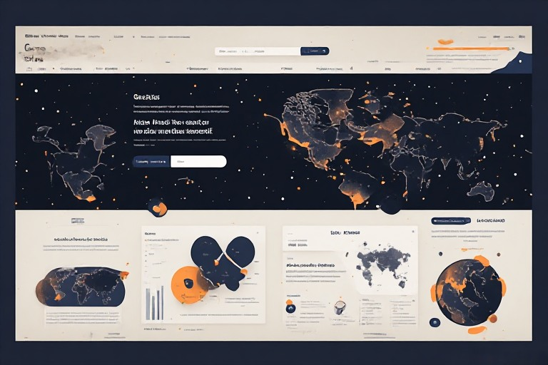

  
  <h1>geo-atlas</h1>
  
<i>Atlas-livre géant bilingue : planisphère interactif, 250 pays, cartes thématiques, versus, quiz et passeport. 100% interactif et animé.</i>

  <a href="https://T2Smart-AI.github.io/perchance-geo-test/">🌐 Live Demo</a> | <a href="showcase.html">✨ Showcase</a>

  
  
  

---

## 🇫🇷 Français

### Description
Le **geo-atlas** est un moteur de génération d'atlas interactif conçu comme un livre numérique géant. Il permet d'explorer le monde via un planisphère, des cartes thématiques et des outils de comparaison, le tout avec des animations fluides.

### Fonctionnalités
- **Navigation Atlas** : Couverture, Planisphère, Continents, Thématiques et Pays (A–Z).
- **Outils Interactifs** : 
    - `Versus` & `Comparateur` : Comparez les données entre pays.
    - `Quiz` : Testez vos connaissances géographiques.
    - `Passeport` : Collectionnez vos visites.
- **Cartographie Thématique** : Visualisation de la population, de la densité et des données politiques.
- **Interface** : Mode nuit, rotation du globe (avec pause) et destinations surprises.

### Contrôles
- **Souris/Toucher** : Cliquez sur les boutons de l'interface pour naviguer entre les pages et explorer les cartes.
- **Clavier** : Navigation via les flèches `←` et `→` pour feuilleter l'atlas.

### Quickstart
- **Windows** : Double-cliquez sur `start.cmd`.
- **macOS/Linux** : Exécutez `sh start.sh`.
- **Alternative** : Lancez `python3 -m http.server` (un serveur HTTP est requis pour charger les modules ES).

### Personnalisation
| Variable | Description |
| :--- | :--- |
| `i18n` | Gestion des langues (EN/FR) |
| `data` | Fichiers JSON pour les pays, la géométrie mondiale et les hymnes |

### Structure du Projet
- `src/app.js` : Cœur de l'application.
- `src/globe3d.js` : Moteur de rendu 3D.
- `src/i18n.js` : Gestion de l'internationalisation.
- `src/data/` : Données géographiques (JSON).
- `src/styles.css` : Design et animations.

### Stack Technique
- **Langages** : JavaScript (ES Modules), CSS3, HTML5.
- **Librairies** : Three.js (0.160.0), Leaflet (1.9.4).
- **Audio** : Web Audio API.
- **Stockage** : localStorage.

### Déploiement
Le projet est optimisé pour **GitHub Pages**.

### Licence
MIT

---

## 🇬🇧 English

### Description
**geo-atlas** is an interactive atlas-book engine. It provides a comprehensive, animated exploration of the world, featuring a planisphere, thematic maps for 250 countries, and interactive educational tools.

### Features
- **Atlas Navigation** : Cover page, World Map, Continents, Themes, and A–Z Country index.
- **Interactive Tools** : 
    - `Versus` & `Comparator` : Compare country metrics side-by-side.
    - `Quiz` : Test your geographic knowledge.
    - `Passport` : Track and collect visited locations.
- **Thematic Mapping** : Specialized views for Population, Density, and Politics.
- **UI/UX** : Night mode, rotation pause, and "Surprise Destination" generator.

### Controls
- **Mouse/Touch** : Use on-screen buttons to flip pages and interact with maps.
- **Keyboard** : Use `←` and `→` arrow keys to navigate through the atlas pages.

### Quickstart
- **Windows** : Double-click `start.cmd`.
- **macOS/Linux** : Run `sh start.sh
