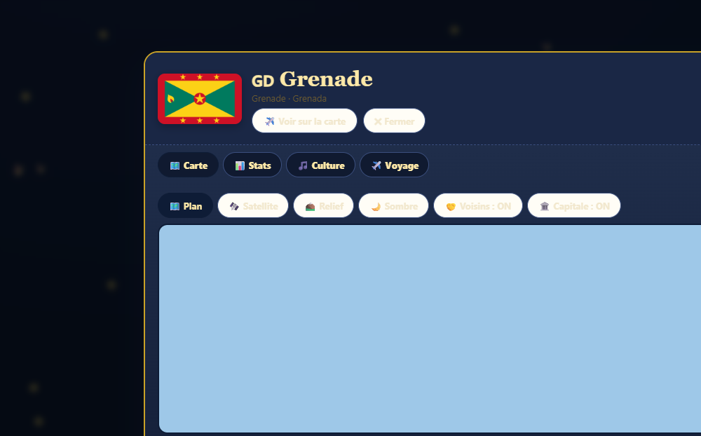

  
  <h1>geo-atlas</h1>
  
<i>Bilingual EN/FR giant interactive atlas-book: planisphere, 250 countries, thematic maps, versus, quiz, passport. 100% interactive & animated.</i>

  
<b>Category:</b> Tools / Engine

  <a href="https://T2Smart-AI.github.io/perchance-geo-test/">🚀 Live Demo</a> | <a href="showcase.html">🖼️ Showcase</a>

  
  
  

---

## 🇫🇷 Français

### Description
Le **geo-atlas** est un moteur de génération d'atlas-livre géant et bilingue. Entièrement interactif et animé, il permet l'exploration détaillée de 250 pays via un planisphère, des cartes thématiques, et des modules de jeu comme le quiz ou le passeport.

### Fonctionnalités
- **Exploration Globale** : Planisphère interactif, vue par continents et navigation A-Z.
- **Données Thématiques** : Cartes dédiées à la population, la densité et la politique.
- **Outils d'Analyse** : Comparateur de pays ("Versus") et sources de données.
- **Gamification** : Système de Quiz et carnet de Passeport.
- **Interface** : Mode nuit, rotation contrôlée et navigation fluide entre les pages.

### Contrôles
- **Souris/Toucher** : Cliquez sur les boutons de navigation (ex: 🗺️ Planisphère, 🎯 Quiz) et interagissez avec les cartes via le pointeur.
- **Clavier** : Navigation via les flèches ($\leftarrow$ / $\rightarrow$).

### Démarrage rapide
- **Windows** : Double-cliquez sur `start.cmd`
- **macOS/Linux** : Exécutez `sh start.sh`
- **Alternative** : `python3 -m http.server` (un serveur HTTP est requis pour les modules ES).

### Personnalisation
| Variable | Description |
| :--- | :--- |
| `src/data/*.json` | Données des pays, hymnes et géométries. |
| `src/styles.css` | Apparence et styles visuels. |
| `src/i18n.js` | Traductions et textes multilingues. |

### Structure du Projet
- `src/app.js` : Cœur de l'application.
- `src/globe3d.js` : Rendu du globe et des interactions 3D.
- `src/data/` : Bases de données JSON.

### Pile Technique
- **Rendu** : Canvas / Three.js (v0.160.0)
- **Cartographie** : Leaflet.js
- **Audio** : Web Audio API
- **Stockage** : localStorage

### Déploiement
Déployé via **GitHub Pages**.

### Licence
Distribué sous licence **MIT**.

 

---

## 🇺🇸 English

### Description
The **geo-atlas** is a bilingual, giant interactive atlas-book engine. Fully animated and interactive, it provides detailed exploration of 250 countries through a planisphere, thematic maps, and gaming modules such as quizzes and passports.

### Features
- **Global Exploration** : Interactive planisphere, continent views, and A-Z country navigation.
- **Thematic Data** : Dedicated maps for Population, Density, and Political boundaries.
- **Analysis Tools** : Country comparison ("Versus") and comprehensive data sources.
- **Gamification** : Integrated Quiz system and Passport collection.
- **UI/UX** : Night mode, rotation pause, and seamless page transitions.

### Controls
- **Mouse/Touch** : Click navigation buttons (e.g., 🗺️ Planisphere, 🎯 Quiz) and interact with maps via pointer.
- **Keyboard** : Use arrow keys ($\leftarrow$ / $\rightarrow$) for navigation.

### Quickstart
- **Windows** : Double-click `start.cmd`
- **macOS/Linux** : Run `sh start.sh`
- **Alternative** : `python3 -
